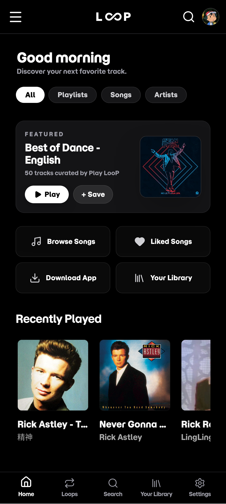
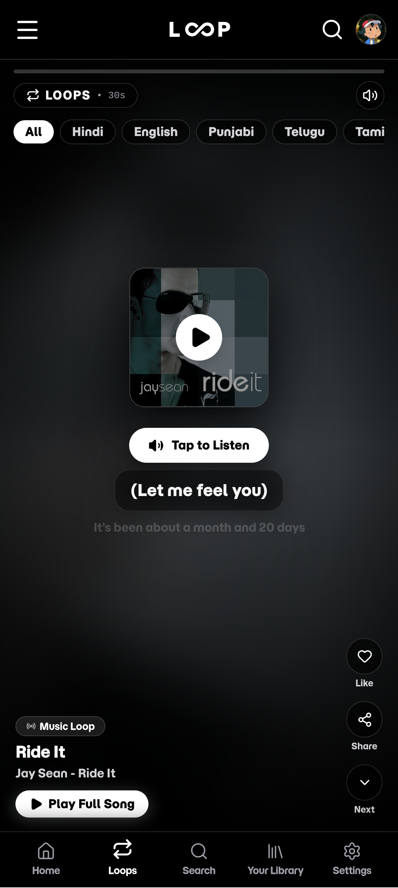
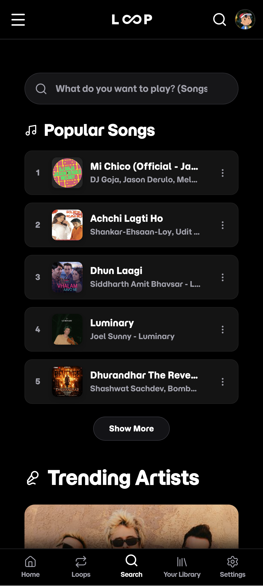
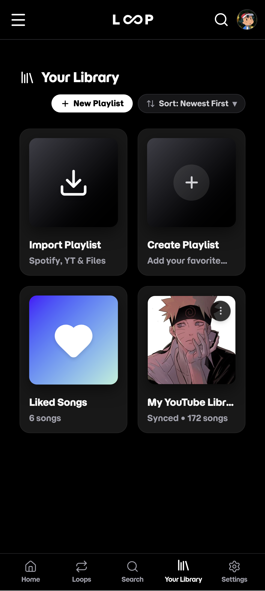
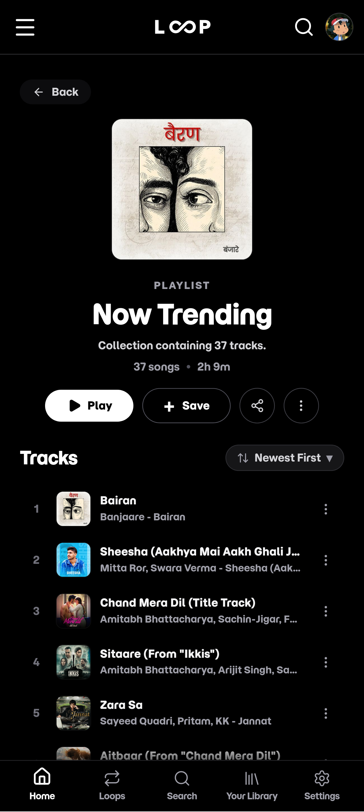
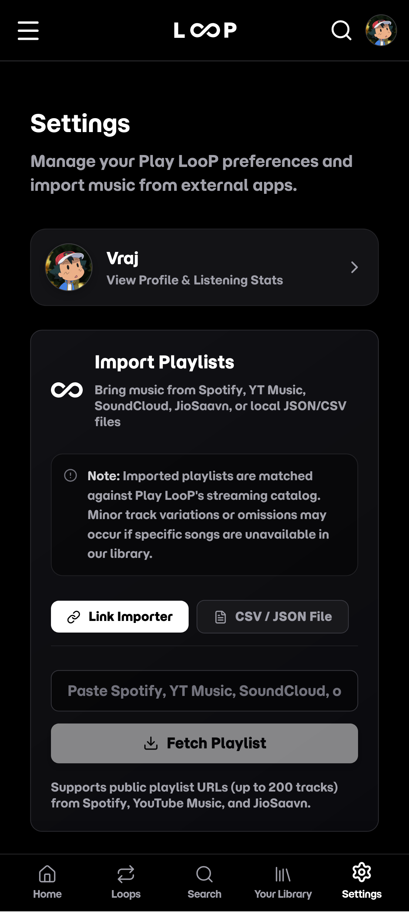

# Play LooP

Play LooP is an ad-free music player built with React and an Express audio proxy backend. It delivers fast stream playback via adaptive HLS, synchronized LRC lyrics, offline downloads, and zero-account cloud playlist synchronization powered by Turso (LibSQL).

The application runs as a responsive web app and can also be deployed as a native Android APK using Capacitor.

Live demo: [play-loop.onrender.com](https://play-loop.onrender.com)

---

## Screenshots

| Home | Loops Discovery | Search & Explore |
| :---: | :---: | :---: |
|  |  |  |

| Your Library | Playlist View | Settings & Importer |
| :---: | :---: | :---: |
|  |  |  |

---

## Features

- Adaptive HLS streaming: Streams audio on-the-fly using adaptive segmenting with preloading for the next track in queue.
- Loops short-form discovery: Dedicated 30-second audio snippet player for quick track discovery with synchronized lyrics and single-tap full playback.
- Synchronized lyrics: Real-time timed LRC lyrics with auto-scroll and line highlighting.
- Multi-platform playlist importer: Import playlists directly from Spotify, YouTube Music, JioSaavn, SoundCloud, or custom JSON/CSV files.
- Up-Next queue and recommendations: Dynamic recommendation pipeline based on current track, genre, and language preferences (English, Hindi, Punjabi, Telugu, Tamil, etc.).
- Playlists and library: Create custom playlists, add tracks across multiple playlists simultaneously, reorder queue items, sort by newest/oldest, and track playback history.
- Device cloud sync: Automatic playlist and library synchronization across devices using anonymous device UUIDs backed by Turso LibSQL, requiring no login credentials or passwords.
- Offline downloads: Download tracks locally with proper ID3 metadata tags for playback without an active internet connection.
- Mobile gestures and PWA: Installable Progressive Web App with MediaSession background audio controls, pull-to-refresh, swipeable navigation tabs, and AMOLED dark mode styling.
- Android APK support: Built-in Capacitor configuration to build and run the app natively on Android devices.

---

## Tech Stack

- Frontend: React 19, Vite, Tailwind CSS v4, Lucide Icons
- Audio and Media: HLS.js, Web Audio API, MediaSession API
- Backend: Node.js, Express 5, Axios, Compression, CORS
- Database: Turso (LibSQL / distributed SQLite edge database)
- Native & PWA: Capacitor 8 (Android runtime and media session bridge), Service Worker

---

## Project Structure

```text
Play-LooP/
├── src/                    # Frontend React application
│   ├── components/         # UI components (Player, FullPlayer, Modals, Navigation)
│   ├── context/            # React context state (PlayerContext audio engine)
│   ├── hooks/              # Custom hooks (touch gestures, pull-to-refresh)
│   ├── pages/              # View routes (Home, Library, Search, Loops, Settings)
│   ├── services/           # Client API layer, lyrics fetcher, share handlers
│   └── styles/             # Tailwind directives and CSS animations
├── server/                 # Express backend application
│   ├── config/             # Turso database connection and schema
│   ├── routes/             # REST endpoints (audio, search, playlists, user sync)
│   └── services/           # Audio stream extraction and provider integrations
├── android/                # Capacitor Android project and native configuration
├── public/                 # Static assets, PWA manifest, and screenshots
├── server.js               # Backend server entry point
├── Dockerfile              # Docker container deployment spec
└── package.json            # Dependencies and scripts
```

---

## Getting Started

### Prerequisites

- Node.js 18 or later
- npm or yarn

### Installation

1. Clone the repository:
   ```bash
   git clone https://github.com/vraj07-11/Play-LooP.git
   cd Play-LooP
   ```

2. Install dependencies:
   ```bash
   npm install
   ```

3. Set up environment variables:
   ```bash
   cp .env.example .env
   ```

   Configure the required variables in `.env`:
   ```env
   PORT=3000
   TURSO_DATABASE_URL=libsql://your-database.turso.io
   TURSO_AUTH_TOKEN=your_turso_auth_token
   ```

### Development

Run the frontend and backend in separate terminal tabs:

- Start the frontend dev server:
  ```bash
  npm run dev
  ```

- Start the backend API server:
  ```bash
  npm start
  ```

### Production Build

Build the static frontend bundle:

```bash
npm run build
```

The compiled assets will be output to the `dist/` directory.

### Running with Docker

You can build and deploy the containerized application using Docker:

```bash
docker build -t play-loop .
docker run -p 3000:3000 --env-file .env play-loop
```

### Android APK Build

This project uses Capacitor to package the web application into an Android APK.

1. Build the web app and sync native Android assets:
   ```bash
   npm run cap:sync
   ```

2. Compile the debug APK using Gradle:
   ```bash
   npm run cap:build-apk
   ```

3. Alternatively, open the Android project in Android Studio:
   ```bash
   npm run cap:open
   ```

---

## API Reference

| Method | Endpoint | Description |
| :--- | :--- | :--- |
| `GET` | `/api/search?q=:query` | Search tracks, artists, and albums |
| `GET` | `/api/audio?id=:id` | Stream audio via adaptive HLS proxy |
| `GET` | `/api/audio/preload?id=:id` | Preload audio stream for upcoming queue tracks |
| `GET` | `/api/download?id=:id` | Download track with embedded metadata |
| `GET` | `/api/song?id=:id` | Fetch detailed track metadata |
| `GET` | `/api/lyrics?id=:id` | Fetch synchronized LRC lyrics |
| `GET` | `/api/recommendations` | Fetch track recommendations based on playback |
| `GET` | `/api/trending-artists` | Fetch current trending artists |
| `GET` | `/api/popular-songs` | Fetch popular tracks filtered by language |
| `GET` | `/api/playlists` | Fetch featured and curated playlists |
| `GET` | `/api/playlist?id=:id` | Fetch playlist track listing |
| `POST` | `/api/playlist/save` | Save or update custom playlist in Turso database |
| `POST` | `/api/playlist/unsave` | Remove saved playlist from database |
| `POST` | `/api/scrobble` | Record listening activity |
| `GET` | `/api/sync?user_uuid=:uuid` | Fetch user playlists, history, and liked tracks |
| `POST` | `/api/sync/history` | Batch synchronize playback history items |
| `GET` | `/api/user/profile` | Fetch user profile data |
| `POST` | `/api/user/profile` | Update user display name and avatar |
| `GET` | `/api/health` | Service health check |

---

## Author

Vraj Gajera

- GitHub: [github.com/vraj07-11](https://github.com/vraj07-11)
- LinkedIn: [linkedin.com/in/vraj-gajera-260a96377](https://www.linkedin.com/in/vraj-gajera-260a96377)
- Email: [gajeravraj593@gmail.com](mailto:gajeravraj593@gmail.com)
